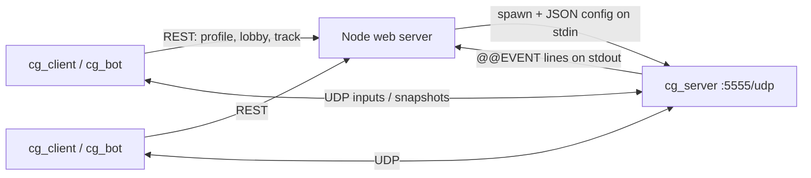

# Native client and dedicated game server

A second way to play the car game: a Windows DirectX 11 client (`cg_client`) and an
authoritative UDP game server (`cg_server`). The game server builds with MSVC and g++ and runs
in a container. The web app is unchanged. Its REST API (profiles, tracks, leaderboards and native
lobbies) is still used to set up matches, so tracks made in the track editor work in the native
client right away.



## Layout

| Path | Contents |
| --- | --- |
| `common/` | Shared library: JSON, logging, track loading, deterministic physics (port of `shared/physics`), protocol, UDP transport with network simulation, client prediction (`clientnet`), HTTP + lobby API client, racing line + AI driver |
| `server/` | `cg_server`: match state machine (waiting → countdown → racing → results → ended), server-side bots |
| `bot/` | `cg_bot`: headless AI client for automated and end-to-end testing |
| `client/` | `cg_client`: D3D11 renderer, Direct2D/DirectWrite HUD, menus, keyboard and XInput |
| `tests/` | `unit`, `ai` and `loopback` tests (ctest) |
| `scripts/e2e.mjs` | End-to-end test through the web server |
| `Dockerfile` | g++ build + tests, slim runtime image for `cg_server` |

## Building

### Windows (Visual Studio 2022 or newer, "Desktop development with C++")

From a *Developer PowerShell / x64 Native Tools* prompt:

```powershell
cd native
cmake -S . -B build\msvc -G Ninja -DCMAKE_BUILD_TYPE=Release
cmake --build build\msvc
ctest --test-dir build\msvc --output-on-failure
```

`-DCG_BUILD_CLIENT=OFF` skips the DirectX client. You can also open the `native` folder in
Visual Studio, which picks up `CMakeLists.txt` directly.

### Linux (g++ 10+, CMake 3.16+)

```bash
cmake -S native -B native/build/release -DCMAKE_BUILD_TYPE=Release -DCG_BUILD_CLIENT=OFF
cmake --build native/build/release -j
ctest --test-dir native/build/release --output-on-failure
```

### Container

Build from the repository root (the tests read `data/tracks`). The image build compiles with g++
and runs all tests:

```bash
docker build -f native/Dockerfile -t car-game-server .
docker run --rm -i -p 5555:5555/udp car-game-server --config - < match.json
```

## Running a game

1. Start the web server (`npm run dev:server`). It finds `cg_server` in `native/build/msvc`,
   `native/build/release`, `native/build` or `native-bin`. You can also set `NATIVE_SERVER_PATH`
   or `NATIVE_SERVER_COMMAND` (see below).
2. Start `native\build\msvc\cg_client.exe` (default API `http://localhost:3000`). Pick a
   nickname and color, then create a lobby (choose track, laps and bots) or join one.
3. Everyone readies up and the host starts the race. The web server reserves a UDP port, starts
   a game server process that already knows the track, the players (with per-player join
   tokens) and the bots, and passes the connection details to each player through the lobby.
4. After the results, or if the game server crashes, stops responding or the connection is lost,
   players go back to the lobby. The lobby shows the reason, for example
   "Game server crashed (exit code 137)".

The profile is stored in `%APPDATA%\CarGameNative\profile.json`, and the client log in
`%APPDATA%\CarGameNative\client.log`.

### Client controls

| Action | Keyboard | Gamepad |
| --- | --- | --- |
| Throttle / brake | W / S or ↑ / ↓ | RT / LT |
| Steer | A / D or ← / → | Left stick |
| Nitro | Space / Left Shift | A |
| Respawn | R | B / Y |
| Leave race | Esc twice | |
| Fullscreen | F11 / Alt+Enter | |

### Debug hotkeys (client)

| Key | Function |
| --- | --- |
| F3 | Network overlay: RTT, jitter, input lead (server-reported and target), predicted vs server tick, re-simulated ticks, snapshot gaps, mispredictions, corrections, bandwidth, simulated conditions, fps |
| F4 | Ghosts: raw predicted/simulated state drawn as outlines next to the smoothed car |
| F5 / F6 | Simulated latency −/+ 25 ms (applied in both directions, live) |
| F7 | Simulated jitter 0 / 10 / 30 ms |
| F8 | Simulated packet loss 0 / 2 / 5 / 10 % |
| F9 | Autopilot (AI drives your car) |

### Command line

`cg_client`:

```text
--api URL  --nickname N  --color C  --profile-file F  --log-file F  --log-level L
--latency MS  --jitter MS  --loss PCT            simulated network conditions
--ai                                             start with autopilot on
--create TRACK_ID [--laps N] [--bots N] [--start-when N]
--join-any  --auto-ready  --exit-after-race      hands-free lobby flow
--server HOST:PORT --token T --track-file F      connect straight to a game server
```

`cg_server`:

```text
--config <file|->   match configuration (JSON, "-" = stdin)
--port N  --bind HOST  --log-level error|warn|info|debug|trace  --log-file PATH
--latency MS  --jitter MS  --loss PCT            simulate conditions on the server side
```

Exit codes: 0 normal, 2 invalid configuration, 3 cannot bind the port.

`cg_bot` runs a headless AI driver using the same client code as `cg_client`:

```text
cg_bot (--server HOST:PORT --token T [--track-file F] | --api URL --nickname N [--create TRACK_ID | --join LOBBY_ID | --join-any])
  [--laps N] [--server-bots N] [--start-when N] [--skill easy|medium|hard] [--color C]
  [--latency MS] [--jitter MS] [--loss PCT] [--script "SEC:key=value;..."]
  [--stats-interval SEC] [--max-seconds SEC] [--no-stdin] [--seed N] [--log-level L]
```

To change network conditions while a race is running, either type `latency 150`,
`jitter 20`, `loss 5`, `stats` or `quit` on the bot's stdin, or give a schedule such as
`--script "5:latency=150;12:jitter=20;20:latency=0"`. At the end the bot prints a
`@@BOT {json}` summary line (outcome, rank, times, RTT, mispredictions, corrections,
resyncs, lobby status and message). Exit codes: 0 finished, 3 lost the server, 4 not
returned to the lobby.

### Match configuration

The web server writes this JSON to the game server's stdin:

```json
{
  "matchId": "abc123-lx2k",
  "port": 5555,
  "lapCount": 3,
  "track": { "...": "full track JSON as stored in data/tracks" },
  "players": [{ "id": "profile-id", "nickname": "Alice", "color": "red", "token": "hex" }],
  "bots": [{ "nickname": "Bot 1", "color": "silver", "skill": "medium" }]
}
```

Optional keys: `trackFile` (instead of `track`), `bindHost`, `snapshotRate` (10–60, default 30),
`countdownSec` (3.5), `waitTimeoutSec` (30), `resultsSec` (8), `clientTimeoutSec` (10),
`finishGraceSec` (60), `statsIntervalSec` (5), and
`netConditions {latencyMs, jitterMs, lossPercent}`.

The server prints one machine-readable line per event on stdout:
`@@EVENT {"type":"ready|joined|left|started|lap|result|ended|error", ...}`. The web server uses
`ready` to mark the match running, and `result` to update the leaderboards (fastest lap and
race time per human player). All other log output goes to stderr and is kept in the lobby's
debug view.

## Networking model

- **Authoritative server** at a fixed 60 Hz tick, using the same physics as the web game,
  ported to C++. Float state is quantized every tick, so client and server re-simulation give
  the same results.
- **Client-side prediction:** the local car is simulated ahead of the server by about one RTT
  plus a small input buffer. Each input is stamped with the tick it applies to.
- **Redundant inputs:** every input packet repeats up to 16 unacknowledged inputs, so a lost
  packet rarely costs an input. The server buffers inputs per tick and repeats the last input
  when one arrives late.
- **Adaptive input lead:** the server reports how early each player's inputs arrive (minimum
  over 250 ms). The client aims for `clamp(1.5 + 2·jitter/tick + loss, 1.5, 15)` ticks and
  adjusts its simulation rate by up to ±8 % to reach it. Large changes (for example a sudden
  latency spike) trigger a hard resync followed by a short hold period.
- **Snapshots** at 30 Hz with all cars, race metadata and the last processed input tick.
  The client rewinds to the snapshot, replays its stored inputs, and smooths any correction
  visually. The correction offset decays over time; corrections larger than 200 px snap.
- **Remote cars** are predicted with their last known input, so collisions with them are
  resolved in the same simulation that drives the local car.
- **Connection health:** heartbeats and timeouts on both sides. Clients detect a lost server in
  about 1.5 s and go back to the lobby. The server removes silent clients after
  `clientTimeoutSec`.

Packets are little-endian, versioned (`CG` magic + version 1) and at most 1400 bytes. Message
types: Hello, Welcome, Reject, Input, Snapshot, Disconnect, Shutdown (see `common/protocol.h`).

## Testing and debugging

| Command | What it covers |
| --- | --- |
| `ctest --test-dir build\msvc` | `unit` (JSON, protocol round trips, physics determinism), `ai` (AI completes laps on several tracks), `loopback` (game server + 2 AI clients + server bot in one process with changing latency/jitter/loss per client; checks finish, corrections, late inputs and lost-server detection) |
| `node native/scripts/e2e.mjs` | Full stack: web server → spawned `cg_server` → 2 `cg_bot` lobby clients with latency changing during the race. Checks results, leaderboards and return to the lobby, then kills the game server mid-race and checks that both clients go back to the lobby with a message |
| `node native/scripts/e2e.mjs --docker car-game-server` | Same, with the game server running in the Linux container |
| `npm test` (repository root) | Includes `tests/nativeMatch.test.ts` for lobby orchestration (fake game server: success, crash, start timeout, HTTP validation) |

Other debugging tools:

- `GET /api/native/debug` shows the lobbies, the port pool, the game server PIDs and the last
  50 log lines of each game server.
- `cg_server --log-level debug` logs per-client stats every 5 s (RTT, input lead, late or
  missed inputs, packets).
- `cg_bot ... --log-level debug` logs client-side stats with `--stats-interval`.
- Run `cg_server` with a hand-written config file and connect `cg_client --server ... --token ...`
  to test without the web server.

## Web server configuration

| Variable | Default | Meaning |
| --- | --- | --- |
| `NATIVE_SERVER_PATH` | first `cg_server(.exe)` found in the build dirs | Game server executable |
| `NATIVE_SERVER_COMMAND` | – | Shell command used instead of the path; `{port}` is replaced. Example: `docker run --rm -i -p {port}:5555/udp car-game-server --config - --port 5555` |
| `NATIVE_PORT_BASE` / `NATIVE_PORT_COUNT` | `5555` / `50` | UDP port pool for concurrent matches |
| `NATIVE_PUBLIC_HOST` | API host | Hostname clients use to reach game servers |
| `NATIVE_READY_TIMEOUT_MS` | `10000` | Game server start timeout |
| `NATIVE_MAX_MATCH_MS` | `1800000` | Hard limit for a match process |
| `NATIVE_LOBBY_IDLE_MS` | `60000` | Remove lobby players that stop polling |

### REST endpoints

- `POST /api/profiles {nickname, color}`, `GET/PUT /api/profiles/:id`
- `GET /api/native/lobbies`, `POST /api/native/lobbies {profileId, trackId, lapCount, botCount}`
- `GET /api/native/lobbies/:id?profileId=`: lobby state; while running it includes that
  player's `connection {host, port, token, matchId}`
- `POST /api/native/lobbies/:id/join|leave|ready|settings|start {profileId, ...}`
- `GET /api/native/debug`
